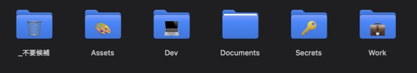

# mac-tidy

> **English:** A small toolkit to keep a Mac home folder tidy. `auto-sort` moves new files in Downloads into typed folders via launchd, `folder-style` adds Finder color tags and emoji folder icons, and `PROMPT.md` / `DAILY-SORT.md` let an AI agent (Claude Code, Codex) reorganize your folders or sort documents by content every morning. Docs are in Japanese.



Mac のホームフォルダを「用途 → 種類 → git 管理の有無」で整理し、その状態を保つためのツールです。

- **auto-sort**: Downloads に入ったファイルを、種類ごとに自動で振り分けます(Desktop で動かすのはスクショだけ)
- **folder-style**: Finder のカラータグと、絵文字付きのフォルダアイコンを付けます
- **PROMPT.md**: Claude Code や Codex に、フォルダの整理そのものを頼むためのプロンプトです
- **rewrite-agent-paths.py**: フォルダを移動したあと、Claude Code と Codex の会話履歴に残る古いパスを書き換えます
- **SETUP-AUTOSORT.md**: AI がユーザーに確認しながら、整理・自動振り分け・色とアイコン・毎朝の仕分けをまとめて設定するための手順書です
- **DAILY-SORT.md**: 毎朝、AI が `Documents/Files` の書類を中身を読んで仕分けるための手順書です

## 必要な環境

- macOS 13 以降(Apple シリコン、macOS 26 で動作を確認)
- zsh(macOS 標準のシェル)
- `folder-style.swift` を使う場合: Xcode Command Line Tools(`xcode-select --install`)
- `rewrite-agent-paths.py` を使う場合: Python 3(Command Line Tools に含まれる)
- auto-sort をバックグラウンドで動かす場合: **フルディスクアクセス**に `/bin/zsh` を追加すること(下の「インストール」を参照)

## AI に頼むだけで使う

Codex や Claude Code に、次のように頼むだけで使えます。

| やりたいこと | 頼み方 |
|---|---|
| フォルダを丸ごと整理する | `https://github.com/yuuyuu86/mac-tidy の PROMPT.md のとおりに整理して` |
| **全部まとめて**設定する(おすすめ) | `https://github.com/yuuyuu86/mac-tidy の SETUP-AUTOSORT.md のとおりにセットアップして` |
| 自動振り分けだけを、範囲を相談しながら設定する | `https://github.com/yuuyuu86/mac-tidy の SETUP-AUTOSORT.md の B だけやって` |
| 毎朝の書類仕分けを設定する | `https://github.com/yuuyuu86/mac-tidy の DAILY-SORT.md のセットアップをやって` |

毎朝の仕分けでは、書類の中身が AI のサービスに送られます。機密書類を扱う場合は、セットアップのときに仕事のフォルダを仕分け先から外してください。

## フォルダ構成

```
~/
├── Dev/
│   ├── Apps/<種類>/{git,local}/   iOS-macOS, Web, Flutter, Unity, Python-AI, IoT …
│   ├── Portfolio/  School/  Contests/  Clones/  Sandbox/
├── Work/<クライアント>/            仕事・チーム開発
├── Assets/                        Images, Videos, Audio, Design, Screenshots, 3DPrint
├── Documents/{Files,Notes,School}/
├── Secrets/                       鍵・証明書・リカバリーコード(chmod 700)
└── _不要候補/                      削除するか本人が決めるもの
```

### 各フォルダに入るもの

#### Dev(開発)
| フォルダ | 入るもの |
|---|---|
| `Apps/<種類>/git/` | git で管理している自作アプリ。種類は iOS-macOS、Web、Flutter、Unity、Python-AI、IoT などで、中身のプロジェクトファイルから判断する |
| `Apps/<種類>/local/` | git で管理していない自作アプリ |
| `Apps/Unity/builds/` | Unity の WebGL などの書き出し結果 |
| `Portfolio/` | ポートフォリオサイト、GitHub のプロフィール用リポジトリ |
| `School/` | 授業の課題や演習のコード |
| `Contests/` | コンテストの企画資料と作品 |
| `Clones/` | 他人のリポジトリを clone したもの |
| `Sandbox/` | 試作や、中身がはっきりしないもの |

#### Work(仕事・チーム開発)
| フォルダ | 入るもの |
|---|---|
| `<クライアント>/` | リポジトリと、関連する worktree |
| `<クライアント>/assets/` | ロゴ、画像、動画などの素材 |
| `<クライアント>/docs/` | 契約書、名簿、仕様書などの書類 |

git の有無では分けません(チーム開発はほぼすべて git で管理しているため)。

#### Assets(コード以外の素材)
| フォルダ | 入るもの | auto-sort の対象 |
|---|---|---|
| `Images/` | png、jpg、heic、gif、webp | ✓ |
| `Images/Wallpapers/` | 壁紙 | 手で分ける |
| `Videos/` | mp4、mov、webm、mkv | ✓ |
| `Audio/` | mp3、wav、m4a、aac | ✓ |
| `Design/` | ai、psd、svg、fig、sketch | ✓ |
| `Screenshots/` | スクリーンショット、画面収録、シミュレータのスクショ | ✓(Desktop も対象) |
| `3DPrint/` | 3mf、stl、gcode | ✓ |

#### Documents(書類)
| フォルダ | 入るもの | auto-sort の対象 |
|---|---|---|
| `Files/` | pdf、docx、xlsx、pptx、csv、key、pages、numbers | ✓ |
| `Notes/` | md、txt のメモ | 手で分ける |
| `School/` | 学校の資料(時間割、申込書、入試書類など) | 手で分ける |

Obsidian の Vault や Processing など、アプリが場所を決めて使うフォルダは動かさずにそのまま残します。

> auto-sort は拡張子だけで行き先を決めるので、授業のプリントのような PDF も `Files/` に入ります。`School/` に入れたい場合は、`auto-sort.sh` の `dest()` に名前で判断するルール(例: `*ワークシート*|*授業*) echo $H/Documents/School;;`)を、拡張子のルールより上に追加してください。

#### Secrets(鍵・証明書)
| 入るもの | auto-sort の対象 |
|---|---|
| `.p8`(App Store Connect API キー)、`.jks` / `.keystore`(Android の署名鍵)、`.cer` / `.p12` / `.mobileprovision`、リカバリーコード | ✓ |

フォルダの権限は `chmod 700` にして、自分だけが開けるようにします。鍵を絶対パスで参照している設定(Android の `key.properties` など)は、移動したあとにパスを直してください。

#### Downloads
| フォルダ | 入るもの |
|---|---|
| `Installers/` | dmg、pkg、iso |
| `Archives/` | zip、tar.gz、7z、rar |

振り分けのルールに当てはまらないファイルは、そのまま Downloads に残ります。

## auto-sort のしくみ

1. launchd が `~/Downloads` と `~/Desktop` の変化を監視します。念のため 60 秒ごとにも起動します。
2. `auto-sort.sh` がファイルの拡張子と名前から行き先を決め、`mv -n` で移動します。
3. ダウンロード中のファイル(`.crdownload` など、または最後の更新から 10 秒以内のファイル)には触りません。
4. 同じ名前のファイルがあるときは、上書きせずに ` (1)` を付けます。

ファイルが振り分けられるまでの時間は、10 秒から 1 分ほどです。

### 対象の範囲

| 場所 | 対象 |
|---|---|
| `~/Downloads` | 下の表のルールに当てはまるファイルすべて |
| `~/Desktop` | **スクリーンショットと画面収録だけ**(ほかのファイルは動かさない) |

対象は、フォルダの**直下にあるファイルだけ**です。サブフォルダの中身と、フォルダそのものは動かしません。

### 振り分けのルール

上から順に判定し、最初に当てはまったルールの行き先に移します。拡張子の大文字と小文字は区別しません。

| 条件 | 行き先 |
|---|---|
| `.p8` `.jks` `.keystore` `.cer` `.p12` `.mobileprovision` `.certSigningRequest`、名前に「recovery codes」を含む | `~/Secrets`(chmod 700) |
| 名前が「スクリーンショット」「画面収録」「Screenshot」「Simulator Screenshot」「Screen Recording」で始まる | `~/Assets/Screenshots` |
| `.png` `.jpg` `.jpeg` `.heic` `.gif` `.webp` | `~/Assets/Images` |
| `.mp4` `.mov` `.webm` `.mkv` | `~/Assets/Videos` |
| `.mp3` `.wav` `.m4a` `.aac` | `~/Assets/Audio` |
| `.ai` `.psd` `.svg` `.fig` `.sketch` | `~/Assets/Design` |
| `.3mf` `.stl` `.gcode` | `~/Assets/3DPrint` |
| `.pdf` `.docx` `.xlsx` `.pptx` `.csv` `.key` `.pages` `.numbers` | `~/Documents/Files` |
| `.dmg` `.pkg` `.iso` | `~/Downloads/Installers` |
| `.zip` `.tar.gz` `.tgz` `.7z` `.rar` | `~/Downloads/Archives` |

### 動かさないもの

- ダウンロード中のファイル(`.crdownload` `.download` `.part` `.tmp`)
- 最後の更新から 10 秒以内のファイル(次の確認のときに動かします)
- `.` で始まる隠しファイルと `desktop.ini`
- 上の表に当てはまらない拡張子(`.txt` `.md` `.json` `.py` `.html` `.exe` など)。Downloads にそのまま残ります

ルールを変えるときは、`auto-sort.sh` の `dest()` を編集してください。範囲やルールを AI に聞かれながら決めたい場合は、[SETUP-AUTOSORT.md](SETUP-AUTOSORT.md) の「B. 自動振り分け」を使ってください。

### インストール

```bash
./install.sh
```

そのあと、**システム設定 → プライバシーとセキュリティ → フルディスクアクセス** に `/bin/zsh` を追加してください(追加画面で ⌘⇧G を押すとパスを入力できます)。これがないと、バックグラウンドで起動したときに Downloads を読めません。

- 解除するとき: `./install.sh --uninstall`
- エラーのログ: `~/Library/Logs/auto-sort.log`
- 振り分けのルールを変えるとき: `~/.local/bin/auto-sort.sh` の `dest()` を編集してください

## folder-style

`folder-style.swift` の `rules` を自分のフォルダに合わせて書き換えてから、次のコマンドで実行します。

```bash
swift folder-style.swift
```

`Dev/Apps/*/git` の中のプロジェクトには緑の `git` タグ、`local` の中には黄色の `local` タグが付きます。
各プロジェクトのフォルダ自体のアイコンは変えません。カスタムアイコンを付けると `Icon\r` という隠しファイルが作られ、git の差分に出てしまうためです。

自分のクライアント名などを入れたルールは `folder-style.local.swift` という名前でコピーして使うと、`.gitignore` の対象になるので公開されません。

## 注意

- 移動の対応表(`*.tsv`)には個人のパスが入るので、`.gitignore` で除外しています。
- `rewrite-agent-paths.py` は AI エージェントの会話履歴を書き換えます。Claude Code の自動モードでは安全チェックで止められるので、**自分のターミナルで**実行してください。実行前に `~/.claude` と `~/.codex` のバックアップを取ってください。
